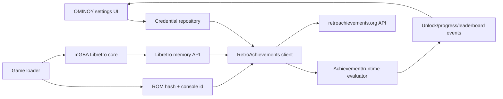
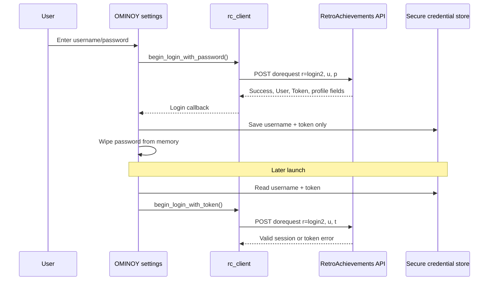

# RetroAchievements integration reference

This document describes the RetroAchievements integration in the RetroArch snapshot used for this review and translates it into an implementation plan for OMINOY. It is a design/reference document, not a copy of RetroArch code.

## Scope and source snapshot

The source reviewed was `libretro/RetroArch` at commit `61c298b7fb270de29a228febfa8ae9ad477be2e6` (shallow checkout on 2026-11-04). OMINOY currently uses the mGBA Libretro core for GB, GBC, and GBA; the relevant declarations are in `retrograde-app-shared/src/main/java/come/asg/lemudroid/lib/library/CoreID.kt:39-43` and `GameSystem.kt:44-150`.

RetroArch’s frontend adapter is in `cheevos/`; the reusable RetroAchievements client, runtime, hashing, and Libretro memory adapter are in `deps/rcheevos/`. The important architectural boundary is that the frontend owns UI, persistence, networking, and Libretro callbacks while `rc_client` owns game identification, achievement evaluation, event generation, and API request construction.



## 1. Login and session flow

RetroArch has two login entry points. The password path calls `rc_client_begin_login_with_password`; the token path calls `rc_client_begin_login_with_token` (`deps/rcheevos/src/rc_client.c:812-875`, public declarations in `deps/rcheevos/include/rc_client.h:165-182`). Both construct an asynchronous request through `rc_client_begin_login` (`deps/rcheevos/src/rc_client.c:763-809`). The frontend supplies the actual HTTP/task callback through `client->callbacks.server_call`.

`rc_api_init_login_request_hosted` builds a URL-encoded POST for the hosted `dorequest` endpoint with `r=login2`, `u=<username>`, and either `p=<password>` or `t=<api token>` (`deps/rcheevos/src/rapi/rc_api_user.c:13-42`). The password and token values are never included in this document or in OMINOY logs.

The server response parser requires a successful response plus `User` and `Token`; it also accepts score, softcore score, message count, avatar URL, and avatar timestamp (`deps/rcheevos/src/rapi/rc_api_user.c:44-96`). `rc_client_login_callback` copies the returned username, display name, avatar data, and token into the in-memory `rc_client_user_t` (`deps/rcheevos/src/rc_client.c:687-760`). RetroArch’s callback then copies the returned token into settings and clears the password (`cheevos/cheevos.c:1690-1757`).



### Credential storage: what RetroArch does

The settings table names the keys `cheevos_username`, `cheevos_password`, and `cheevos_token` and marks them sensitive (`configuration.c:2100-2105`). In the current snapshot, sensitive settings are written to a separate file named `retroarch-keychain.cfg` beside the main config (`configuration.c:9347-9377`, `9380-9477`). On a later load that file is merged before normal config overrides (`configuration.c:7206-7251`). If saving succeeds, the sensitive keys are stripped from `retroarch.cfg`; if it fails, RetroArch warns and keeps them in the main config (`configuration.c:9693-9708`).

The separate file is not automatically encrypted in every build. With `HAVE_KEYCHAIN`, RetroArch seals values using its keychain mechanism when available; if the keychain is locked or unavailable, the code warns that credentials may be written in the clear (`configuration.c:9420-9431`). The file is made owner-private after writing, but that is filesystem permission, not encryption (`configuration.c:9494-9504`). Therefore the accurate answer is: the token is stored under the `cheevos_token` key in `retroarch-keychain.cfg` in the current implementation, with optional keychain sealing; it is not guaranteed to be encrypted.

RetroArch’s password is a live setting and can be part of the sensitive-settings set. After a successful login the callback clears it, while changing the username clears both password and token and changing the password clears the token (`cheevos/cheevos.c:1729-1736`; `menu/menu_setting.c:11587-11595`). The current source does not provide a single generic “logout” UI path in the reviewed excerpts that explicitly deletes the credential file. It clears the in-memory token when a token is expired or invalid (`cheevos/cheevos.c:1695-1718`), and unload destroys the client when the config token is empty so the next game load must authenticate again (`cheevos/cheevos.c:919-927`). OMINOY should make logout explicit: delete the secure token and username, clear the client, and never retain the password.

### Token reuse and invalid-token handling

On game load, RetroArch creates or reuses an `rc_client`, configures its host and mode, and chooses token login when `cheevos_token` is non-empty; otherwise it uses the username/password fields (`cheevos/cheevos.c:2032-2134`). A failed login shows an error. An expired token or invalid saved token clears the token and tells the user to log in again (`cheevos/cheevos.c:1695-1718`). OMINOY should implement the same state machine without falling back to a persisted password.

## 2. Game identification and GB-family specifics

RetroAchievements identifies a game from a console-specific ROM hash. The hash iterator maps `.gb`, `.gba`, and `.gbc` to Game Boy, Game Boy Advance, and Game Boy Color console IDs (`deps/rcheevos/src/rhash/hash.c:1230-1245`). The file-hash dispatcher includes all three console IDs (`deps/rcheevos/src/rhash/hash.c:812-845`); the buffer path also accepts them (`deps/rcheevos/src/rhash/hash.c:502-519`). The resulting hash is sent during game-set loading and session start; OMINOY should pass the original ROM bytes or a stable local file to the rcheevos hashing API, not a display name or database metadata.

The Libretro console IDs are distinct: Game Boy is `RC_CONSOLE_GAMEBOY`, Game Boy Color is `RC_CONSOLE_GAMEBOY_COLOR`, and Game Boy Advance is `RC_CONSOLE_GAMEBOY_ADVANCE` (`deps/rcheevos/src/rcheevos/consoleinfo.c:1086-1093`). Extension-to-console dispatch is a useful default for OMINOY, but a future implementation should keep the detected system ID from the library entry so a mislabeled file cannot silently select the wrong achievement set.

For GB, the address model includes cartridge ROM, video RAM, cartridge save RAM, fixed and banked system RAM, I/O, and extra cartridge-RAM banks (`deps/rcheevos/src/rcheevos/consoleinfo.c:451-478`). GBC adds banked system RAM and the same extended cartridge-RAM convention (`deps/rcheevos/src/rcheevos/consoleinfo.c:480-506`). GBA maps internal work RAM, external work RAM, and save RAM into the achievement address space (`deps/rcheevos/src/rcheevos/consoleinfo.c:508-515`). These are rcheevos’ logical achievement addresses; they are not a claim that mGBA exposes one contiguous pointer with these exact offsets.

## 3. Memory access through Libretro

RetroArch obtains its core memory descriptors, unwraps them into `retro_memory_map`, and calls `rc_libretro_memory_init` with the game console ID and a fallback `get_core_memory_info` callback (`cheevos/cheevos.c:171-204`). The adapter chooses one of three strategies: use the console map when present, use `retro_get_memory_data`/`retro_get_memory_size` through the callback when no map is available, or use the console’s unmapped-memory fallback (`deps/rcheevos/src/rc_libretro.c:720-748`).

Reads are logical-address reads over registered regions. `rc_libretro_memory_read` walks regions, copies bytes, handles reads spanning region boundaries, and stops at an unmapped region (`deps/rcheevos/src/rc_libretro.c:393-426`). RetroArch connects this to `rc_client` through `rcheevos_client_read_memory`, which delegates to `rc_libretro_memory_read` (`cheevos/cheevos.c:1640-1644`).

For mGBA, OMINOY must verify at runtime that the bundled mGBA core exposes the relevant GB/GBC/GBA memory through a usable Libretro memory map or through `retro_get_memory_data` and `retro_get_memory_size`. At minimum, the core must expose live system/work RAM and save RAM in a way that the rcheevos logical regions can map. If only a null pointer or an unrelated buffer is exposed, achievement conditions will not evaluate correctly. This exact mGBA exposure is **UNVERIFIED** from the OMINOY repository because OMINOY downloads/packages the core binary rather than containing the mGBA core source in this checkout.

## 4. Runtime loop, progress, unlocks, and leaderboards

RetroArch calls `rcheevos_test` once per emulation frame. When memory is available it calls `rc_client_do_frame`; otherwise it calls `rc_client_idle` (`cheevos/cheevos.c:1193-1228`). `rc_client_do_frame` updates memory references, evaluates active achievements, updates progress, evaluates leaderboards when hardcore or the configured softcore policy allows it, raises pending events, and then services scheduled work (`deps/rcheevos/src/rc_client.c:6441-6507`).

An achievement state transition to triggered queues an award request and raises a frontend event; measured-value changes update the progress tracker (`deps/rcheevos/src/rc_client.c:6047-6110`, `6188-6231`). A triggered leaderboard is converted into a submission request, and the event handler exposes started, failed, submitted, and scoreboard events (`deps/rcheevos/src/rc_client.c:6251-6313`, `6355-6388`; `cheevos/cheevos.c:711-780`). OMINOY needs a frame hook that runs after the core has produced the current frame and a UI/event bridge that can show unlock, progress, and leaderboard state without blocking emulation.

## 5. Hardcore versus softcore

RetroArch enables hardcore in the client, validates settings, and enforces restrictions when a game is loaded (`cheevos/cheevos.c:2107-2134`). Entering hardcore validates incompatible settings, refuses to enable when active cheats or invalid settings are present, disables rewind, turns off slow motion, and notifies command/netplay layers (`cheevos/cheevos.c:942-1040`). Save-state creation and loading are rejected while hardcore is active (`tasks/task_save.c:1241-1244`, `1568-1571`).

The complete list of core-specific disallowed settings is data-driven in `deps/rcheevos/src/rc_libretro.c:24-195`; the generic frontend must also account for its own features. OMINOY should initially enforce the restrictions it actually provides: save-state creation/load, rewind, fast-forward or slow-motion modes, cheats, memory editing, and any debug or input manipulation that changes game state. Do not expose a hardcore toggle until each supported bypass is either disabled or explicitly classified as safe. The rcheevos client also blocks leaderboard submission when not in hardcore (`deps/rcheevos/src/rc_client.c:5477-5514`).

## 6. Offline and failure handling

RetroArch routes HTTP through asynchronous task callbacks. `cheevos/cheevos_client.c:245-310` owns the adapter from a RetroArch HTTP task to the rcheevos server callback; its URL logging is disabled by default and filters password/token parameters when URL logging is enabled (`cheevos/cheevos_client.c:48-64`, `192-238`). Server errors, disconnects, and reconnects become user-visible events (`cheevos/cheevos.c:668-709`).

The client retries leaderboard submissions immediately once and then with increasing delays up to a two-minute maximum (`deps/rcheevos/src/rc_client.c:5380-5446`). The start-session response also carries prior normal and hardcore unlock records (`deps/rcheevos/src/rapi/rc_api_user.c:103-220`), so a fresh session can reconcile state. The reviewed code does not establish a durable, app-level offline queue for every unlock; it schedules pending client work and can resync after reconnection. OMINOY should treat unlock delivery as at-least-once at the client boundary, persist only the minimum non-secret retry metadata if needed, and make failures visible without logging request bodies.

### OMINOY ownership model for cancellation and retries

The emulator session should own a `CoroutineScope` backed by a `SupervisorJob`. Game exit cancels that scope so frame-bound work cannot outlive the session. The emulation thread must never perform network I/O: it should publish unlock, progress, and error events to a `Channel`, while a coroutine drains the channel and invokes the client/network boundary.

Before session cancellation completes, OMINOY should flush pending unlock work inside `withContext(NonCancellable)` so a last-second event is not discarded. Failed submissions should be persisted in a small non-secret queue and retried by WorkManager with a network constraint, allowing delivery to survive process death. Login and token validation belong to an application-scoped repository rather than the session scope, so a game exit cannot invalidate account state.

## RetroArch concept → OMINOY implementation

| RetroArch concept | Verified file/function/lines | What OMINOY needs to implement |
|---|---|---|
| Login request | `deps/rcheevos/src/rc_client.c:763-875`; `deps/rcheevos/src/rapi/rc_api_user.c:13-42` | A coroutine or suspend wrapper for password login and token login; POST form encoding; no request-body logging. |
| Login response/token | `deps/rcheevos/src/rc_client.c:687-760`; `cheevos/cheevos.c:1690-1757` | Parse success/user/token; retain only username and token; wipe password immediately after use. |
| Credential persistence | `configuration.c:9347-9377`, `9380-9506`, `9693-9708` | Android Keystore-backed encrypted storage; never plain-text SharedPreferences or normal config. |
| Token reuse/expiry | `cheevos/cheevos.c:1695-1718`, `2032-2134`, `919-927` | Try token first; on invalid/expired token delete it and require interactive login. |
| ROM identification | `deps/rcheevos/src/rhash/hash.c:1230-1245`, `812-845` | Hash exact GB/GBC/GBA ROM bytes with the rcheevos hashing API and retain the console ID. |
| Memory mapping | `cheevos/cheevos.c:171-204`, `1640-1644`; `deps/rcheevos/src/rc_libretro.c:720-748` | Obtain Libretro memory map/data/size from LibretroDroid; map mGBA RAM and save RAM to rcheevos logical regions. |
| Per-frame evaluation | `cheevos/cheevos.c:1193-1228`; `deps/rcheevos/src/rc_client.c:6441-6507` | Invoke `doFrame` once per emulated frame and `idle` while paused or awaiting memory. |
| Unlock/progress UI | `deps/rcheevos/src/rc_client.c:6047-6110`, `6188-6231`; `cheevos/cheevos.c:711-780` | Translate events to Android state flows and notifications. |
| Leaderboards | `deps/rcheevos/src/rc_client.c:6251-6313`, `6355-6388`, `5477-5514` | Enable only under the chosen hardcore policy; surface retry and submission state. |
| Hardcore enforcement | `cheevos/cheevos.c:942-1040`; `tasks/task_save.c:1241-1244`, `1568-1571` | Gate save states, rewind, cheats, speed manipulation, and other state-changing features. |
| HTTP/task bridge | `cheevos/cheevos_client.c:245-310` | Non-blocking HTTP executor with cancellation, timeout, reconnect, and bounded retries. |

## Recommended OMINOY storage design

Use an Android Keystore-protected encryption key with an encrypted preferences or small encrypted database record containing only the RetroAchievements username and token. Store no password after login. Bind the record to the app installation, clear it on logout, and clear it when token validation fails. Keep token access behind a narrow repository interface so UI, logging, analytics, crash reports, and database exports cannot accidentally read it.

This is stronger than copying RetroArch’s portable config behavior because OMINOY is an Android app with a platform keystore. It also avoids treating a token like an ordinary user preference. If an encrypted-preferences library is adopted, verify its current Android support and backup behavior; exclude the encryption key and token material from cloud/device backups unless an explicit migration design exists. **UNVERIFIED:** the current OMINOY checkout does not contain an existing RetroAchievements credential repository or an already-selected encrypted-preferences library.

## Pseudocode

```text
login(username, password):
    response = POST /dorequest { r: "login2", u: username, p: password }
    require response.Success and response.User and response.Token
    secureStore.write(username = response.User, token = response.Token)
    wipe(password)
    client.loginWithToken(response.User, response.Token)

reuseToken():
    creds = secureStore.read()
    if creds is absent: return NEEDS_LOGIN
    result = client.loginWithToken(creds.username, creds.token)
    if result is EXPIRED or INVALID:
        secureStore.clear()
        return NEEDS_LOGIN
    return result

identify(romBytes, system):
    console = {GB: GAMEBOY, GBC: GAMEBOY_COLOR, GBA: GAMEBOY_ADVANCE}[system]
    hash = rcheevosHash(console, romBytes)
    client.identifyAndLoadGame(hash)

onFrame():
    if memoryMapIsReady:
        client.doFrame()       // reads mGBA memory and evaluates conditions
    else:
        client.idle()
    drainEvents { unlock, progress, leaderboard, error }
```

## What to build first

1. Add a small RetroAchievements domain/client boundary and a secure credential repository. Define logout and token-invalidated states before adding UI.
2. Add a settings screen for username, password entry, login, logout, and a hardcore opt-in. Do not expose or display the token.
3. Integrate rcheevos login, game identification, and async HTTP using an OMINOY-owned task/coroutine bridge.
4. Add exact GB/GBC/GBA ROM hashing and verify that known supported test ROMs resolve to a game set without recording credentials or request bodies.
5. Add LibretroDroid/mGBA memory-map plumbing and a diagnostic-only validation that required memory regions are non-null and readable; remove diagnostic logging before release.
6. Probe LibretroDroid’s native layer for `RETRO_ENVIRONMENT_SET_MEMORY_MAPS` and `retro_get_memory_data`. If memory maps do not cross the JNI boundary, add the smallest possible native/JNI read-at-address bridge rather than guessing at Kotlin-side addresses.
7. Run an mGBA probe after game load. For GB/GBC, record the availability and size of work RAM, high RAM, and cartridge RAM. For GBA, record internal work RAM, external work RAM, and save RAM. Compare results with the rcheevos definitions cited above; do not proceed to achievement UI until required regions are readable.
8. Invoke the client once per emulated frame, then add unlock, progress, error, and reconnect UI. Keep network work off the emulation thread and route events through a channel.
9. Enforce hardcore restrictions around every OMINOY feature that can alter emulation state, especially save states, rewind, cheats, and speed controls.
10. Add WorkManager retry tests, session-cancellation tests, last-frame flush tests, token expiry tests, logout/deletion tests, process-death tests, and upgrade/migration tests for the secure store.

## Licensing and attribution

RetroArch is GPLv3, and OMINOY is also GPLv3. This document intentionally paraphrases RetroArch behavior and cites paths and functions instead of copying large code blocks. If OMINOY ports or links RetroArch frontend code, preserve the applicable GPLv3 notices and source-distribution obligations. The embedded `deps/rcheevos/LICENSE` in the reviewed RetroArch snapshot is MIT-licensed; retain its copyright and permission notice if OMINOY incorporates rcheevos code. Confirm the exact dependency version and license files at implementation time. RetroAchievements service terms, API compatibility, and branding requirements should also be reviewed before release; they are outside this code-reference document.

## Open questions and verification items

- **UNVERIFIED:** Whether the current LibretroDroid native sources handle `RETRO_ENVIRONMENT_SET_MEMORY_MAPS` and expose `retro_get_memory_data` through JNI. Settle this with a small source grep and, if needed, a minimal native/JNI probe.
- **UNVERIFIED:** Whether the exact mGBA binaries distributed by OMINOY expose readable GB/GBC work RAM, high RAM, and cartridge RAM, plus GBA internal work RAM, external work RAM, and save RAM at the expected sizes. Settle this with a post-load probe and compare it with the rcheevos maps.
- The proposed lifecycle is: application scope for login/token validation; emulator-session scope for frame work; WorkManager for persisted failed submissions under a network constraint. Validate the final choice against OMINOY’s existing ViewModel/service ownership before implementation.
- **UNVERIFIED:** Whether an Android backup/migration policy should preserve the encrypted RetroAchievements session or require login again on a new installation.
- RetroArch’s current source has a portable `retroarch-keychain.cfg` fallback; OMINOY should not copy that fallback unless there is a deliberate desktop-style portability requirement.

## References

[1]: https://github.com/libretro/RetroArch/tree/61c298b7fb270de29a228febfa8ae9ad477be2e6 "RetroArch source snapshot reviewed"
[2]: https://github.com/Amarthya-sg/OMINOY "OMINOY target repository"
